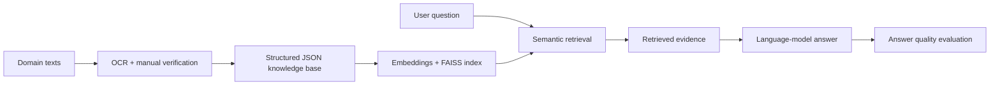

## Illustrative process

<LocaleContent lang="en">

## Overview

AcuBQA is a bilingual retrieval-augmented question-answering system designed to reduce domain hallucinations in general-purpose language models and support acupuncture education and clinical information workflows.

## Domain Knowledge Preparation

The structured JSON knowledge base covers 361 acupoints, 14 meridians and clinical-case materials. I processed source documents with varied layouts using OCR-assisted extraction and manual checking, then organized the content into consistent fields while preserving relationships between knowledge entities.

## Retrieval & Generation

The system indexes 1024-dimensional MC-BERT and BGE-large-zh embeddings with FAISS and integrates Qwen, HuatuoGPT-II and Baichuan for answer generation. Retrieved passages accompany generated answers so users can trace responses to source materials.

## My Contributions

I built the bilingual RAG workflow across domain-data preparation, knowledge structuring, retrieval, language-model integration and evaluation. I also compared retrieval approaches and analyzed errors across retrieval and generation.

## Evaluation

Using RAGAS evaluation aligned with cBLUE, the system achieved 74.9% recall and 78.9% factual accuracy, while reducing domain-specific error rates by about 18% compared with general-purpose models.

## What I Learned

This work connects data preparation, retrieval engineering and evaluation in one applied-AI workflow. It also illustrates how document quality and knowledge representation can affect downstream language-model behavior.

</LocaleContent>

<LocaleContent lang="zh">

## 项目概述

AcuBQA 是一个中英双语检索增强问答系统，旨在减少通用大语言模型在针灸领域的错误回答，并支持针灸教学与临床信息应用。

## 领域知识准备

结构化 JSON 知识库涵盖 361 个穴位、14 条经脉和临床案例资料。我使用 OCR 辅助提取并人工核对不同版式的原始文档，再统一字段、整理内容，同时保留知识实体之间的关系。

## 检索与生成

系统使用 MC-BERT 和 BGE-large-zh 生成 1024 维嵌入，并通过 FAISS 建立索引；回答生成整合了 Qwen、HuatuoGPT-II 和 Baichuan。检索资料会与回答关联，便于追溯信息来源。

## 个人贡献

我参与构建双语 RAG 工作流，负责领域数据处理、知识结构化、检索系统开发、语言模型接入与评估，并比较检索方案、分析检索和生成环节中的错误来源。

## 评估

基于 cBLUE 对齐的 RAGAS 评估中，系统的召回率为 74.9%，事实准确率为 78.9%；与通用模型相比，领域错误率降低约 18%。

## 项目收获

这一工作将数据准备、检索工程和系统评估连接为一套应用 AI 流程，也体现了原始文档质量与知识表示方式如何影响后续语言模型表现。

</LocaleContent>
