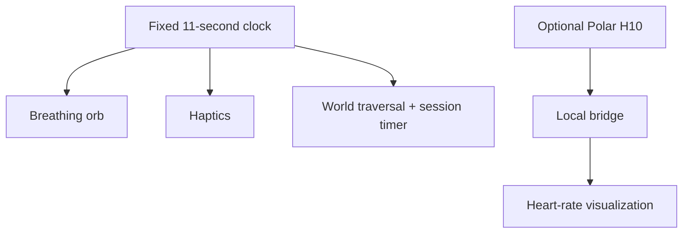

## Illustrative process

<LocaleContent lang="en">

## Overview

Drift is a seated XR experience built around slow, regularly paced breathing. It combines visual cues, haptic signals and changes in virtual scenery. The design addresses a practical demonstration problem: a sensor may disconnect or provide unstable signals, yet the main experience should remain coherent.

## Two Independent Channels

A fixed 11-second cycle controls the breathing orb, haptics, traversal and session timing. Separately, an optional Polar H10 chest strap supplies heart-rate data through a local processing path for numerical or color-based visualization. Heart rate is displayed, but it does not control the breathing pace or scene progression.

## Interaction Sequence

The demo manuscript describes a five-minute session with preparation, a warm-up period and repeated visual-world transitions aligned to breathing phases. This architecture allows the rhythmic interaction to continue when real-time sensing is unavailable.

## My Contributions

I contributed video editing and figure design for the Unity/OpenXR demo, helping communicate its interaction sequence and the distinction between breathing guidance and physiological visualization.

## Design Rationale

Separating guidance from measurement keeps the breathing experience consistent while allowing optional heart-rate visualization to add physiological context. The demo provides a basis for future study of this interaction design.

</LocaleContent>

<LocaleContent lang="zh">

## 项目概述

Drift 是以缓慢、规律呼吸为核心的坐姿 XR 体验，结合视觉提示、触觉信号和虚拟场景变化。设计针对一个实际演示问题：生理传感器可能断连或输出不稳定，但主要体验仍应保持连贯。

## 双通道设计

固定的 11 秒周期控制呼吸球、触觉反馈、场景移动和会话计时。另一条独立通道通过可选的 Polar H10 胸带，经本地处理向数字或颜色可视化提供心率数据。心率只用于显示，并不决定呼吸节奏或场景推进。

## 交互流程

Demo 稿件描述了约五分钟的体验，包括准备、热身及与呼吸阶段同步的场景切换。这样的架构使实时传感不可用时，节奏引导仍可继续。

## 个人贡献

我为这一 Unity/OpenXR Demo 剪辑演示视频并设计图表，呈现交互流程，以及呼吸引导与生理可视化之间的区别。

## 设计取舍

将引导与测量分开，让呼吸体验保持稳定，同时由可选的心率可视化补充生理信息。该 Demo 为后续研究这一交互设计提供基础。

</LocaleContent>
