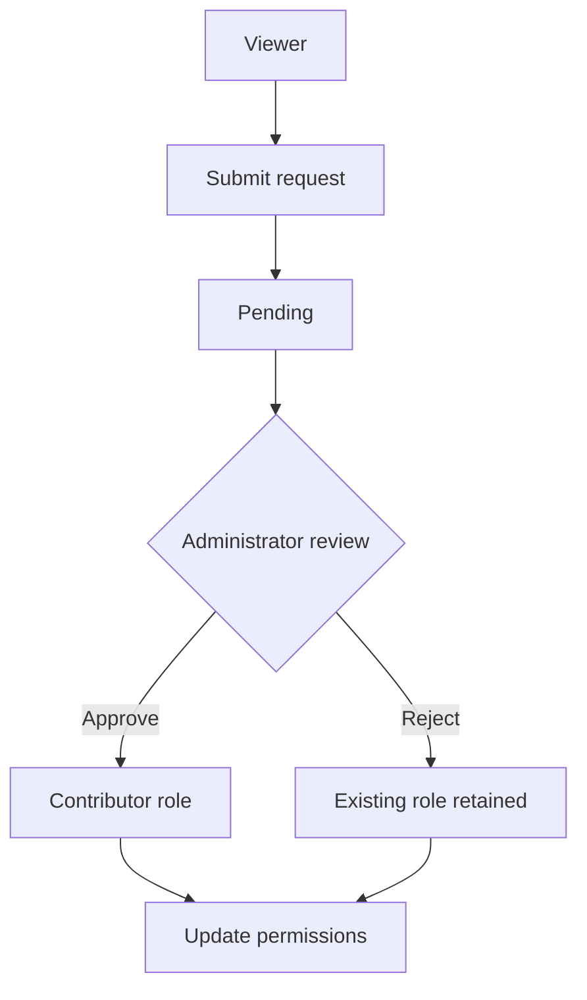

## Illustrative process

<LocaleContent lang="en">

## Problem & System Scope

I worked in a nine-member course team to build a web platform for submitting, reviewing and browsing community heritage resources. My focus was User & Role Administration.

## User Roles

The module supports ADMIN, CONTRIBUTOR and VIEWER roles, with editable profiles, administrator-side user search and filtering, server-side pagination, role updates and contributor-application workflows. It keeps application status aligned with role changes and API permission checks.

## My Implementation

I developed the frontend and backend of the User & Role Administration module, including profile editing, user lists, contributor application submission, administrator approval/rejection and RBAC-related logic. I also worked with database interactions, API debugging and integration with adjacent modules.

## Architecture & Integration

The platform uses Vue 3, Axios and Vite 5 on the frontend, with a Spring Boot backend and MySQL storage. I integrated the User & Role Administration module with the team's shared AuthService, aligning login state, JWT role information, API contracts and authorization checks.

## Representative Workflow

A user submits a rationale to request contributor status; the application enters PENDING; an administrator reviews and approves or rejects it; and the corresponding authorization state is updated. The project demonstrates why UI states, backend validation and business-state transitions must agree.

## Engineering Lessons

The project gave me practical experience integrating module interfaces, permission rules and shared application services across a team-built system.

</LocaleContent>

<LocaleContent lang="zh">

## 问题与系统边界

我和九人课程团队共同开发了这一 Web 平台，连接社区文化遗产资料提交、审核与浏览流程。我主要负责用户与角色管理模块。

## 用户角色

模块支持 ADMIN、CONTRIBUTOR 与 VIEWER 三种角色，包含用户资料编辑、管理员端搜索与筛选、服务端分页、角色更新及 Contributor 申请流程，并将申请状态与角色变更和 API 权限检查联动。

## 个人实现

我负责用户与角色管理模块的前后端开发，包括资料编辑、用户列表、Contributor 申请提交、管理员通过或拒绝操作以及 RBAC 相关逻辑，并参与数据库交互、接口排错和跨模块集成。

## 架构与联调

平台前端使用 Vue 3、Axios 和 Vite 5，后端采用 Spring Boot 与 MySQL。我将用户与角色管理模块接入团队统一的 AuthService，协调登录状态、JWT 角色信息、接口约定和权限检查。

## 代表性业务流程

用户填写申请理由提交 Contributor 资格申请后，状态进入 PENDING；管理员审核并作出通过或拒绝决定；系统随后更新对应授权状态。这个流程体现出界面状态、后端验证与业务状态流转必须保持一致。

## 工程收获

项目让我积累了在团队系统中整合模块接口、权限规则与共享应用服务的实践经验。

</LocaleContent>
