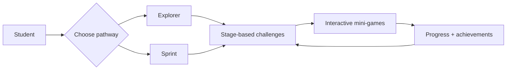

## Illustrative process

<LocaleContent lang="en">

## Problem & Users

Postgraduate applications combine research, deadlines, documentation and many smaller decisions. Students at different preparation stages may struggle with different parts of the process. MasterApply Quest approached this as a human-centered computing problem: how can an intimidating workflow become easier to explore and learn?

## Design Concept

The web prototype presents two paths, Explorer and Sprint, for different user needs. It uses application-stage content, interactive text-based mini-games, progress feedback and achievement mechanisms to turn selected application concepts into tasks. The prototype turns selected application knowledge into interactive learning activities.

## User-Centered Process

The course project connected target-user analysis with interaction planning, prototype development and evaluation. Project materials document user flows, design rationale, role-specific experiences and usability reflections.

## Implementation

The prototype uses Vue 3, Vite and Tailwind CSS to deliver the browser-based experience. The prototype includes two pathways, six mini-games, stage progress and achievement feedback.

## My Contributions

As project lead, I coordinated requirements, user research, development planning, interaction design and team progress. I also participated in core prototype development and helped connect users' needs with implementation decisions.

## Evaluation & Reflection

The project portfolio records early user feedback and design reflections that informed the prototype. The outcome is a working interactive course prototype supported by a documented design process.

</LocaleContent>

<LocaleContent lang="zh">

## 用户问题

研究生申请涉及信息检索、截止日期、材料准备和一系列决策。处于不同准备阶段的学生可能遇到不同问题。MasterApply Quest 将其视为人本计算问题：如何让复杂的申请流程变得更容易理解和探索？

## 产品概念

Web 原型为不同需求提供 Explorer 与 Sprint 两条路径，通过申请阶段内容、文字互动小游戏、进度反馈和成就机制，将部分申请知识转化为可操作任务。原型将部分申请知识转化为互动学习活动。

## 以用户为中心的过程

课程项目将目标用户分析与交互规划、原型开发和评价相结合。项目材料记录了用户流程、设计理由、不同角色体验与可用性反思。

## 技术实现

原型使用 Vue 3、Vite 和 Tailwind CSS 构建浏览器端体验。原型包含两条体验路径、六款小游戏、阶段进度和成就反馈。

## 个人贡献

作为项目组长，我统筹需求、用户调研、开发规划、交互设计和团队进度，并参与核心原型开发，推动用户需求与具体实现方案之间的衔接。

## 评价与反思

项目作品集记录了早期用户反馈和设计反思，并为原型调整提供参考。项目成果是一套可交互的课程原型，以及对设计过程的完整记录。

</LocaleContent>
