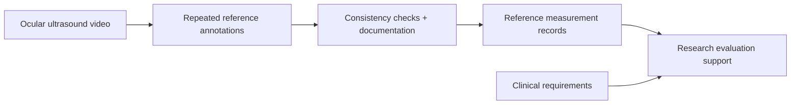

## Illustrative process

<LocaleContent lang="en">

## Clinical Research Context

Optic nerve sheath diameter measurement from ocular ultrasound video is a specialized imaging task. My work supported its automation research through reference measurements, annotation procedures and clinical requirements gathering.

## Reference Measurement Workflow

I created gold-standard optic nerve sheath diameter measurements by entering and averaging repeated annotations, checking consistency and documenting annotation rules for algorithm development and evaluation.

## Clinical Requirements

I also assisted in collecting requirements from three tertiary hospitals in Shanghai and communicating relevant practical concerns to the research team. The experience highlighted the importance of connecting data preparation and technical decisions to the conditions in which an imaging workflow may be used.

## My Contributions

I prepared annotation data, checked measurement consistency, documented procedures and gathered clinical requirements as part of the research team.

## Research Output

The associated paper, “Automated measurement of optic nerve sheath diameter using ocular ultrasound video,” was published in Medical & Biological Engineering & Computing, 64(2), 419–433 (2026).

</LocaleContent>

<LocaleContent lang="zh">

## 临床研究背景

利用眼部超声视频测量视神经鞘直径是一项专业医学影像任务。这项自动化研究需要可靠的参考测量、可重复的标注方法，以及对实际临床需求的理解。我参与了这些研究基础工作。

## 参考测量流程

我录入并平均多次标注结果，建立视神经鞘直径参考测量值，核查测量一致性并记录标注规则，为算法开发与评价提供金标准数据。

## 临床需求

我还协助收集上海三家三甲医院的需求，并将相关实践问题传递给研究团队。这段经历让我认识到数据准备和技术方案需要联系医学影像流程实际使用的环境。

## 个人贡献

我参与标注数据整理、一致性核查、流程记录和需求收集，与研究团队共同推进这项工作。

## 研究成果

相关论文《Automated measurement of optic nerve sheath diameter using ocular ultrasound video》发表于《Medical & Biological Engineering & Computing》2026 年第 64 卷第 2 期，页码 419–433。

</LocaleContent>
