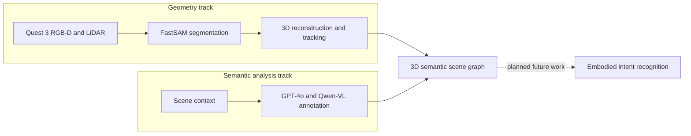

## Illustrative process

<LocaleContent lang="en">

## Overview

3D reconstruction provides geometry, but coordinates and surfaces alone do not explain what objects are, what they can be used for, or how they relate to their surroundings. SemanticTwin examines how geometric representations can be connected with semantic descriptions so that XR applications and future intelligent agents can work with more structured scene knowledge.

## Research Questions

The work is organized around three questions: how to represent physical scenes in a consistent 3D coordinate system; how to interpret objects, attributes and functional relationships using visual context; and how to connect these outputs into a machine-readable scene graph.

## Technical Approach

I am developing an MR workflow that combines Quest 3 RGB-D sensing, LiDAR, FastSAM segmentation, 3D reconstruction and tracking, and Qwen VLM annotation. The geometry and semantic tracks connect scene objects, spatial locations and functional relationships in a machine-readable 3D scene graph.

## My Contributions

As project lead, I coordinate six team members across environment reconstruction and semantic-intelligence work. I set research directions, organize technical reviews, track development milestones, and review consistency between spatial coordinates and functional relationships across components.

## Progress & Evidence

Current work connects spatial reconstruction with visual-language analysis of object semantics, building a knowledge-aware scene graph from scene geometry, object attributes and functional relationships.

## Next Steps

Next, I plan to explore how spatial semantic representations can support intent recognition in embodied AI settings.

</LocaleContent>

<LocaleContent lang="zh">

## 项目概述

三维重建能够获取环境的几何信息，但单纯的坐标和表面并不能解释物体是什么、具有哪些用途以及它们与周围物体有何关系。SemanticTwin 探索如何将几何表示与语义描述结合，使 XR 应用和未来的智能体能够利用更结构化的场景知识。

## 研究问题

研究围绕三个问题展开：如何在一致的三维坐标系中表示真实场景；如何利用视觉上下文理解物体、属性与功能关系；以及如何将几何和语义输出组织为机器可读取的场景图。

## 技术路线

我正在开发一套 MR 工作流，整合 Quest 3 RGB-D 感知、LiDAR、FastSAM 分割、三维重建与追踪，以及 Qwen VLM 标注。几何与语义两条路线共同连接场景物体、空间位置和功能关系，生成机器可读取的三维语义场景图。

## 个人贡献

作为项目负责人，我协调六人团队推进环境重建与语义智能研究，负责规划研究方向、组织技术评审、跟踪开发进度，并检查各模块中空间坐标与功能关系的一致性。

## 进展与证据

目前的工作将空间重建与视觉语言语义分析结合起来，从场景几何、物体属性和功能关系构建具备知识关联的场景图。

## 后续方向

后续我计划在毕业设计中进一步探索空间语义表示如何支持具身智能中的意图识别。

</LocaleContent>
