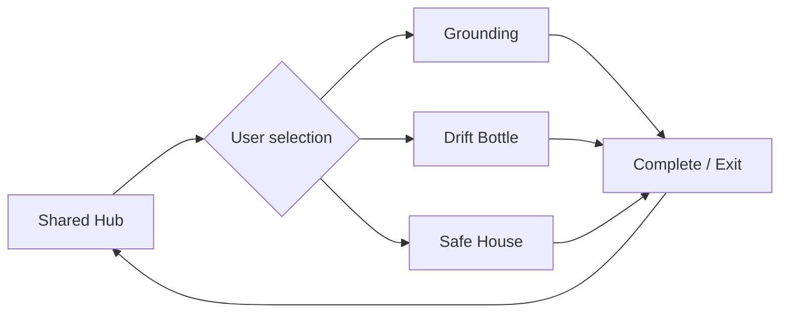

## Illustrative process

<LocaleContent lang="en">

## Overview

VR coping-oriented experiences often use different interaction forms. The VR Coping Hub brings these experiences together in a shared launcher. Users choose a module, enter it, and return to the Hub when they finish or exit.

## Grounding

Grounding organizes sensory orientation and guided interaction in a restorative virtual setting. The module helps users focus on elements of the immediate immersive environment through an intentional sequence of cues and actions.

## Drift Bottle

Drift Bottle uses a metaphorical bottle interaction to externalize difficult feelings. Its five-minute Quest 3 sequence links paced breathing, narrative prompts, spatial triggers, visual effects and water-related interactions. The separate Drift demo explores breath-paced locomotion.

## Safe House

Safe House lets users personalize an environment through curated, reversible object choices, choosing which elements appear or change.

## My Contributions

I co-developed three CBT-informed VR modules: adapting a restorative forest into a multisensory Grounding sequence, and building a PCVR Safe House with anchor-based curated object switching. For the five-minute Meta Quest 3 Drift Bottle ritual, I used a state machine to coordinate paced breathing, emotion visualization, narration, spatial triggers, smoke effects and water physics without menu interaction.

</LocaleContent>

<LocaleContent lang="zh">

## 项目概述

面向应对式体验的 VR 交互形式各不相同。VR Coping Hub 将这些体验整合在共享启动界面中，用户可以自行选择模块，完成或退出后返回 Hub。

## 感官锚定

Grounding 在具有恢复性氛围的虚拟环境中组织感官注意与引导性交互，通过有序的提示和操作使用户关注当下环境中的具体体验。

## 漂流瓶模块

Drift Bottle 通过象征性的漂流瓶交互外化负面感受。其约五分钟的 Quest 3 体验将呼吸节奏、叙事提示、空间触发、视觉效果和水面交互结合起来。另一个独立的 Drift Demo 则探索呼吸节奏控制的场景移动。

## 安全屋

Safe House 允许用户通过预先设计、可撤销的物体选择来个性化虚拟空间，自主决定哪些元素出现或变化。

## 个人贡献

我参与开发三个 CBT 导向的 VR 模块：将恢复性森林场景改造成多感官 Grounding 流程，并为 PCVR Safe House 实现基于锚点的精选物体切换。针对五分钟的 Meta Quest 3 Drift Bottle 体验，我使用状态机协调节奏呼吸、情绪可视化、旁白、空间触发、烟雾效果和水体物理交互，全程无需菜单操作。

</LocaleContent>
