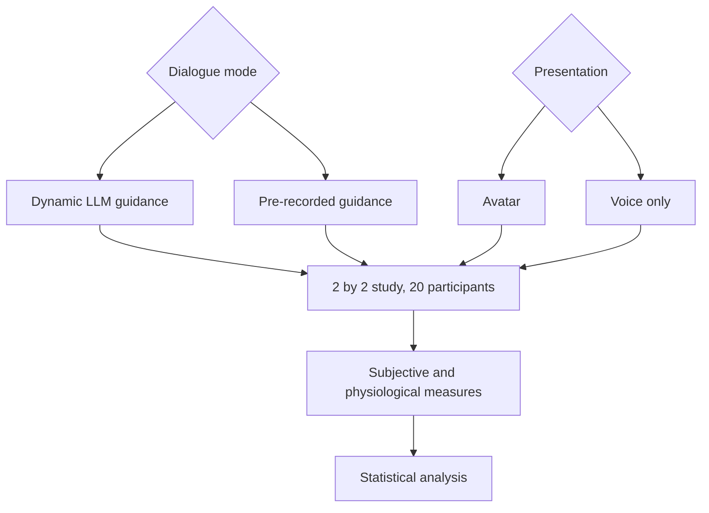

## Illustrative process

<LocaleContent lang="en">

## Research Motivation

Immersive environments provide a setting for guided experiences. This project studies how conversational style and virtual-human presence shape users’ experience of a VR stress-recovery system.

## VR System

The ART-grounded system combines an immersive Meta Quest 3 environment, domain-specialized LLM dialogue and a high-fidelity virtual avatar to deliver interactive, grounding-oriented guidance. OpenSignals bioEX-5 records heart rate, HRV, EEG and respiration during the study.

## Experimental Design

A 2 × 2 between-subjects study involved 20 participants. The two factors were dialogue mode (LLM-driven or prerecorded guidance) and embodiment (avatar or voice-only), forming four experimental conditions. This design helps separate the effect of dialogue style from that of avatar presentation.

## Measures & Analysis

I analyzed STAI-S, SP, RT, PRS and SSQ scores using ANCOVA, Bonferroni post-hoc comparisons and Cohen's d. In this study, the avatar-plus-LLM condition produced the highest subjective restoration, while voice-only guidance was associated with faster physiological recovery.

## My Contributions

I co-developed the VR system, coordinated sessions with 20 participants, collected physiological data and analyzed subjective and physiological outcomes.

</LocaleContent>

<LocaleContent lang="zh">

## 研究动机

沉浸式环境为引导式体验提供了场景。本项目研究对话方式与虚拟人呈现如何影响用户对 VR 压力恢复系统的体验。

## VR 系统

系统以注意力恢复理论为基础，结合 Meta Quest 3 沉浸式环境、领域专用 LLM 对话和高保真虚拟人，提供互动式引导。研究使用 OpenSignals bioEX-5 采集心率、HRV、脑电和呼吸数据。

## 实验设计

研究采用涉及 20 名参与者的 2×2 组间实验。两个因素分别是对话方式（LLM 动态引导或预录制脚本）与具身呈现（虚拟人或纯语音），形成四组实验条件，以便区分对话方式和虚拟人呈现的作用。

## 测量与分析

我使用 ANCOVA、Bonferroni 事后比较和 Cohen's d 分析 STAI-S、SP、RT、PRS 与 SSQ 量表结果。在本研究中，虚拟人加 LLM 条件下的主观恢复评分最高；纯语音引导则与更快的生理恢复相关。

## 个人贡献

我参与 VR 系统开发，组织 20 名参与者的实验，采集生理数据，并分析主观和生理指标。

</LocaleContent>
